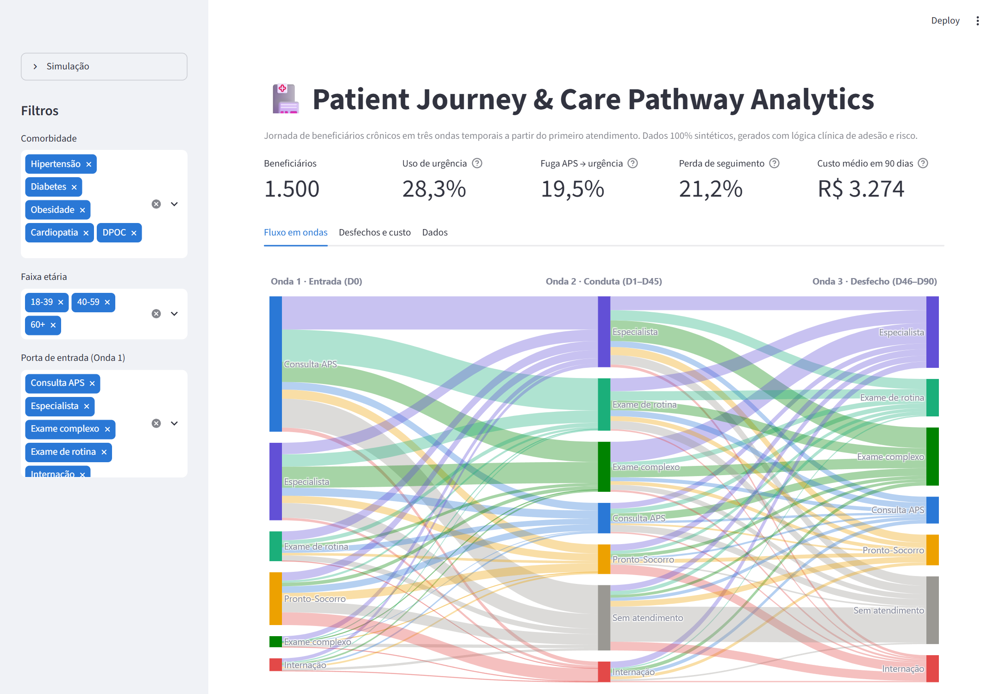
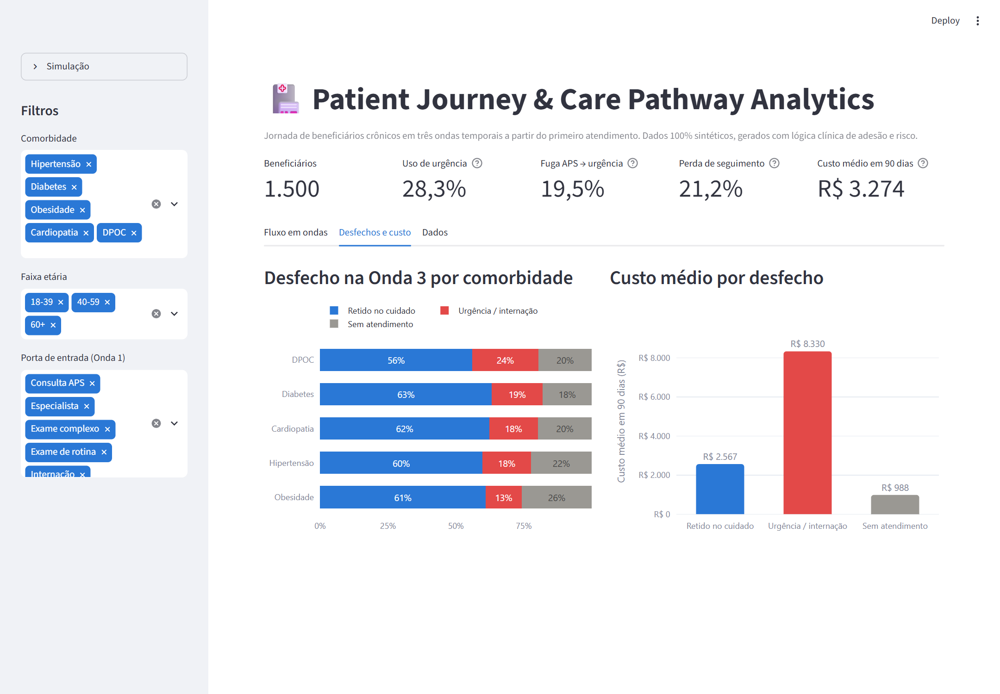
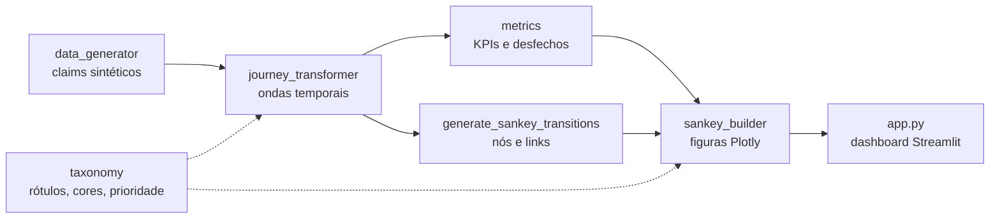

# 🏥 Patient Journey & Care Pathway Analytics

[](https://github.com/claisonnascimento/healthcare-patient-journey-sankey/actions/workflows/ci.yml)
[](https://www.python.org/)
[](https://streamlit.io/)
[](https://plotly.com/python/sankey-diagram/)
[](LICENSE)

> **Mapeamento da jornada de beneficiários crônicos em ondas temporais de atendimento, para revelar onde a linha de cuidado se rompe e quanto isso custa à operadora.**



---

## 📌 O problema

Na **Gestão de Saúde Populacional (GSP)**, o paciente crônico (hipertenso, diabético, cardiopata, DPOC, obeso) que perde o acompanhamento eletivo tende a descompensar e reaparecer no **Pronto-Socorro** ou numa **internação**, os eventos mais caros da carteira.

Os dados de utilização (*claims*) registram cada atendimento isoladamente. Este projeto transforma esses registros em uma **jornada sequencial por ondas temporais** e responde três perguntas de negócio:

1. **Por onde o paciente entra** no sistema (APS, especialista, urgência)?
2. **O que acontece em seguida**: ele é investigado e acompanhado, ou some?
3. **Como termina o trimestre**: retido no cuidado, em urgência ou sem atendimento? E **quanto custa** cada caminho?

## 💡 Principais achados (dados sintéticos, 1.500 beneficiários)

| Indicador | Valor |
|---|---|
| Beneficiários que usaram urgência no seguimento (D1–D90) | **28,3%** |
| Custo médio em 90 dias, **com** urgência | **R$ 8.102** |
| Custo médio em 90 dias, **sem** urgência | **R$ 1.365** (~6× menor) |
| Perda de seguimento: nenhum contato entre D46 e D90 | **21,2%** |
| "Fuga" APS → urgência: entraram pela APS e depois usaram urgência | **19,5%** |

- **DPOC** é a condição com maior taxa de desfecho em urgência (24%), contra 13% em obesidade.
- Obesidade, por outro lado, tem a **maior perda de seguimento** (26%): um grupo que se descompensa menos no curto prazo mas abandona o cuidado.
- Quem fica **sem atendimento na Onda 2** só volta a ser retido no cuidado em 24% dos casos (contra 70% de quem foi acompanhado), e termina em urgência com mais frequência (22% vs. 17%). É o ponto ideal para **busca ativa** pela equipe de GSP.



> ⚠️ Todos os dados são **sintéticos**. Os números acima demonstram a metodologia e não representam nenhuma operadora real.

---

## 📐 Metodologia: ondas temporais

A data do primeiro atendimento de cada beneficiário é a **data índice (D0)**. Os eventos seguintes são agrupados em janelas:

| Onda | Janela | Significado |
|---|---|---|
| **Onda 1 · Entrada** | D0 | Porta de entrada no período |
| **Onda 2 · Conduta** | D1–D45 | Investigação, exames, retorno |
| **Onda 3 · Desfecho** | D46–D90 | Longitudinalidade: retenção vs. urgência vs. perda |

Duas regras de modelagem tornam o fluxo fiel à realidade assistencial:

- **Evento de maior acuidade representa a onda.** Se o paciente fez um exame de rotina e foi ao PS na mesma janela, a onda registra o PS (`Internação > PS > Exame complexo > Especialista > Exame de rotina > APS`).
- **Ausência de contato é um estado, não um descarte.** Janelas vazias viram `Sem atendimento`, então nenhum beneficiário é removido e a descontinuidade do cuidado fica visível no Sankey.

As janelas são parametrizáveis em [`src/journey_transformer.py`](src/journey_transformer.py) (`DEFAULT_WAVES`).

## 🧬 Dados sintéticos com lógica clínica

Em vez de sortear eventos ao acaso, o gerador ([`src/data_generator.py`](src/data_generator.py)) simula cada jornada como uma **cadeia de Markov**:

- Cada beneficiário recebe **comorbidade**, **faixa etária** e um perfil **latente de adesão** (62% aderentes).
- A probabilidade de transição para PS/internação é multiplicada pelo **risco clínico** (ex.: cardiopatia 1,6×, DPOC 1,5×), pela **idade** (60+ 1,4×) e pela **adesão** (não aderente 2,4×, aderente 0,5×).
- Não aderentes têm **intervalos maiores entre consultas** e **maior chance de abandonar** o acompanhamento.
- Custos seguem **distribuições log-normais** por tipo de evento (consulta APS ~R$ 110, internação ~R$ 9.500).

O resultado é um dataset reprodutível (semente fixa) em que o mecanismo de negócio, **baixa adesão → urgência → custo**, existe de fato e pode ser descoberto pela análise.

---

## 🛠️ Arquitetura



```
healthcare-patient-journey-sankey/
├── app.py                     # Dashboard Streamlit (filtros, KPIs, abas)
├── src/
│   ├── taxonomy.py            # Eventos, rótulos, prioridade de acuidade e cores semânticas
│   ├── data_generator.py      # Simulação Markoviana de claims (também roda via CLI)
│   ├── journey_transformer.py # Claims → jornadas por onda → transições do Sankey
│   ├── metrics.py             # KPIs de linha de cuidado e tabelas de desfecho
│   └── sankey_builder.py      # Figuras Plotly (Sankey, desfecho, custo)
├── tests/                     # Testes unitários com jornadas conhecidas (pytest)
├── assets/                    # Capturas de tela do dashboard
├── data/                      # Saída opcional do gerador (ignorada pelo Git)
└── .github/workflows/ci.yml   # Lint (ruff) + testes em Python 3.10 e 3.12
```

**Decisões de design**

- **Funções puras** entre as camadas: cada etapa recebe e devolve `DataFrame`, o que facilita testes e permite trocar o gerador sintético por uma base real de claims sem tocar no restante.
- **Taxonomia centralizada**: rótulos, prioridades e cores ficam em um único módulo, então o Sankey e os gráficos de desfecho usam sempre a mesma linguagem visual (tons frios = cuidado eletivo, tons quentes = urgência, cinza = ausência de cuidado).
- **Testes orientados ao negócio**: além do esquema, os testes verificam conservação de fluxo no Sankey, a regra de acuidade, o horizonte de 90 dias e que o mecanismo "urgência eleva custo" existe nos dados gerados.

---

## 🚀 Como executar

```bash
git clone https://github.com/claisonnascimento/healthcare-patient-journey-sankey.git
cd healthcare-patient-journey-sankey

python -m venv .venv
# Windows: .venv\Scripts\activate  |  Linux/macOS: source .venv/bin/activate
pip install -r requirements.txt

streamlit run app.py
```

No dashboard você pode filtrar por **comorbidade**, **faixa etária** e **porta de entrada**, ajustar o **tamanho da simulação** e baixar a tabela de jornadas em CSV.

**Gerar o dataset em CSV** (opcional):

```bash
python -m src.data_generator --n-patients 5000 --seed 7
# -> data/raw/synthetic_claims.csv
```

**Testes e lint:**

```bash
pip install -r requirements-dev.txt
pytest
ruff check .
```

---

## 🧭 Próximos passos

- [ ] Comparar o percurso real com a **linha de cuidado ideal** de cada diretriz clínica (aderência ao protocolo).
- [ ] Modelo preditivo de **risco de descompensação** a partir das Ondas 1 e 2.
- [ ] Conector para bases reais no padrão **TISS/ANS**.
- [ ] Coortes por mês de entrada para acompanhar a evolução da carteira.

---

## 👤 Autor

**Claison do Nascimento** · [GitHub](https://github.com/claisonnascimento)

Distribuído sob a licença [MIT](LICENSE).
